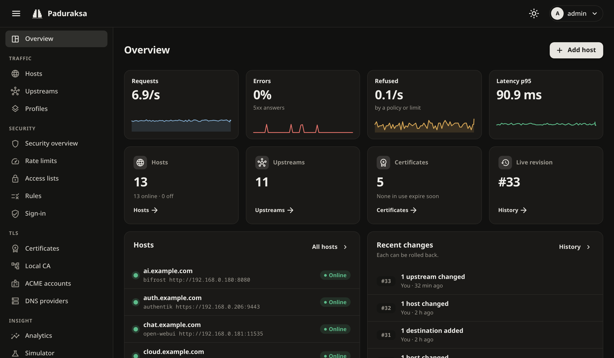

# Paduraksa

A self-hosted reverse proxy for homelabs, built on Kestrel and YARP. Deploy it once, then manage hosts, certificates and
users from a web dashboard or a REST API, with every change reviewed first, versioned and reversible.

> [!WARNING]
> Pre-alpha. It works end to end, but expect breaking changes until v0.1, and don't put it in front of anything that
> matters yet.

*Paduraksa*: the gate into the inner sanctum, flanked by guardian figures meant to keep evil out.



## What it does

HTTP/1.1, HTTP/2 and HTTP/3 with a certificate per name; ACME (HTTP-01, DNS-01) and a built-in local CA; access lists, rule sets, rate limits,
a proof-of-work browser check and forward-auth to authentik, Authelia or oauth2-proxy; a review before every change, drafts and rollback;
logs, metrics, analytics and notifications; a REST API, YAML import and export, a CLI and an MCP endpoint. The documentation has all of it.

## Quick start

With Docker and Compose v2:

```sh
mkdir paduraksa && cd paduraksa
curl -fsSLO https://raw.githubusercontent.com/hizkifw/paduraksa/main/deploy/compose.yaml
head -c 32 /dev/urandom | base64 | sudo install -m 400 -o 10001 -g 10001 /dev/stdin master.key   # the vault's master key, a Docker secret
docker compose up -d
docker logs paduraksa 2>&1 | grep -A8 "Paduraksa first-run setup"   # the one-time setup token
```

Keep a copy of `master.key` somewhere other than this machine: nothing else opens the vault. Then open `https://localhost:9443/` on the
server (or through `ssh -L 9443:127.0.0.1:9443 you@server`) and create the Owner with the setup token. The compose file maps ports
**80/tcp, 443/tcp and 443/udp** one to one (443/udp is HTTP/3).

The image is `ghcr.io/hizkifw/paduraksa`, for amd64 and arm64.

## Documentation

The documentation is at [www.paduraksa.org](https://www.paduraksa.org/). Its source is in [`docs/`](docs/), built as a site with MkDocs (`mkdocs.yml`):

- [Getting started](docs/guide/getting-started.md): from `docker compose up` to a service behind HTTPS.
- [User guide](docs/guide/hosts-and-routes.md) and [operating it](docs/operating/docker.md): hosts, upstreams, TLS, security, backups, upgrades.
- [The REST API](docs/automation/api.md), [MCP](docs/automation/mcp.md) and [the command line](docs/automation/cli.md).
- [Threat model](docs/threat-model.md): what Paduraksa defends against, what it does not, and what to do about it.
- [Design](docs/PLAN.md) and the [roadmap](docs/PLAN.md#14-milestones). Performance against nginx, Caddy, HAProxy, Traefik, Envoy and a
  bare YARP reference is in [bench/RESULTS.md](bench/RESULTS.md).

The PROXY protocol parser is also published on its own, for other .NET projects: [`Paduraksa.ProxyProtocol`](src/Paduraksa.ProxyProtocol/README.md) (BCL only) and
[`Paduraksa.ProxyProtocol.AspNetCore`](src/Paduraksa.ProxyProtocol.AspNetCore/README.md) (a Kestrel `UseProxyProtocol`).

## Development

You need the .NET 10 SDK.

```sh
dotnet build
dotnet test
```

The checks CI runs, the data directory, database migrations and the repository layout are in
[docs/development.md](docs/development.md).

## License

[Apache-2.0](LICENSE). See [NOTICE](NOTICE).
