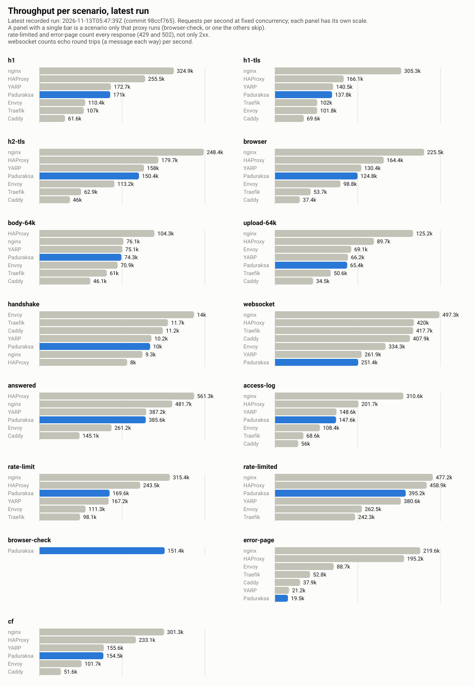
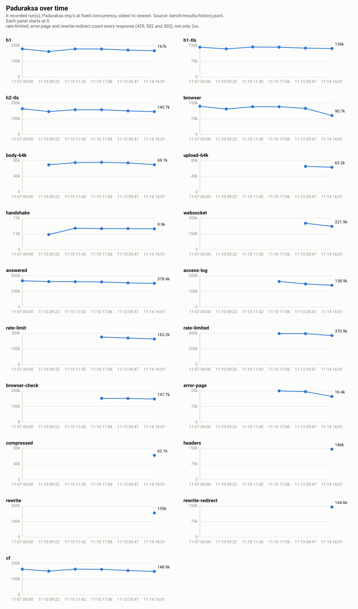
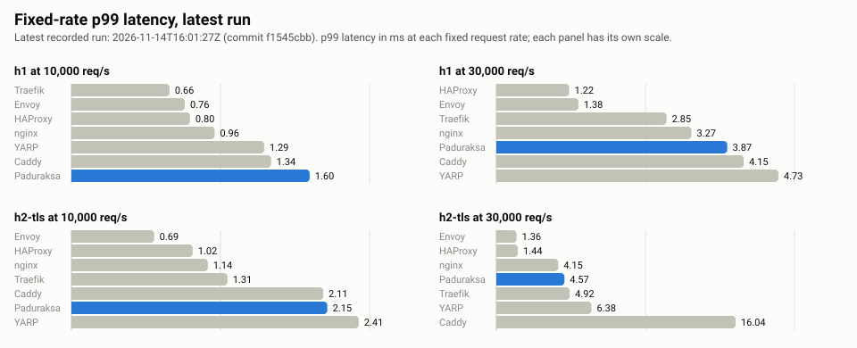

# Benchmark results

Generated by `bench/history.py report` from `bench/results/history.jsonl`, tables and SVG charts alike. Method, fairness rules and caveats: [bench/README.md](README.md). Runs are recorded with `RECORD=1 bench/run-baseline.sh`; only `summary.md`, `summary.json` and `env.txt` are committed per run.

4 recorded run(s).

## Latest run

2026-11-10T17:06:32Z · commit `ba02cad5` · 13th Gen Intel(R) Core(TM) i5-13600K · 20 logical CPUs · CPU sets: proxy 0-3, load 4-11, upstream 12-19.

### Throughput at fixed concurrency (successful requests/s)

| Scenario | Paduraksa | nginx | Caddy | HAProxy | Traefik | Envoy | YARP | Paduraksa ÷ nginx |
|---|---:|---:|---:|---:|---:|---:|---:|---:|
| h1 | 178,206 | **323,238** | 72,351 | 284,142 | 105,427 | 113,233 | 177,749 | 0.55 |
| h1-tls | 142,414 | 229,379 | 70,324 | **232,269** | 101,761 | 105,236 | 142,539 | 0.62 |
| h2-tls | 157,976 | **246,909** | 46,481 | 234,545 | 62,580 | 112,919 | 163,556 | 0.64 |
| browser | 132,620 | **218,491** | 37,903 | 214,260 | 53,720 | 102,765 | 135,374 | 0.61 |
| body-64k | 75,757 | 78,634 | 51,338 | **106,793** | 60,974 | 71,220 | 74,684 | 0.96 |
| handshake | 10,025 | 9,062 | 11,248 | 8,059 | 11,312 | **14,185** | 10,207 | 1.11 |
| answered | 401,129 | **842,593** | 210,495 | 590,669 | - | 269,604 | 380,674 | 0.48 |
| access-log | 163,485 | - | - | - | - | - | - | - |
| rate-limit | 175,950 | - | - | - | - | - | - | - |
| rate-limited | 395,616 | - | - | - | - | - | - | - |
| browser-check | 151,991 | - | - | - | - | - | - | - |
| error-page | 19,962 | - | - | - | - | - | - | - |
| cf | 162,153 | - | - | - | - | - | - | - |

`rate-limited` and `error-page` count every response (429 and 502), not only 2xx: for those rows the number is what the proxy refused or failed, and their `errors` column is the same count.

### Latency at fixed concurrency (ms)

| Scenario | Proxy | req/s | p50 | p99 | p99.9 | errors |
|---|---|---:|---:|---:|---:|---:|
| h1 | Paduraksa | 178,206 | 0.34 | 0.80 | 2.02 | 0 |
| h1 | nginx | **323,238** | **0.20** | **0.24** | **0.27** | 0 |
| h1 | Caddy | 72,351 | 0.68 | 2.99 | 3.78 | 0 |
| h1 | HAProxy | 284,142 | 0.21 | 0.31 | 0.33 | 0 |
| h1 | Traefik | 105,427 | 0.49 | 2.96 | 4.15 | 0 |
| h1 | Envoy | 113,233 | 0.53 | 0.95 | 0.99 | 0 |
| h1 | YARP | 177,749 | 0.34 | 0.75 | 2.08 | 0 |
| h1-tls | Paduraksa | 142,414 | 0.43 | 0.96 | 2.20 | 0 |
| h1-tls | nginx | 229,379 | 0.29 | 0.38 | 0.40 | 0 |
| h1-tls | Caddy | 70,324 | 0.70 | 3.05 | 3.92 | 0 |
| h1-tls | HAProxy | **232,269** | **0.27** | **0.34** | **0.37** | 0 |
| h1-tls | Traefik | 101,761 | 0.51 | 3.02 | 4.27 | 0 |
| h1-tls | Envoy | 105,236 | 0.58 | 0.92 | 0.95 | 0 |
| h1-tls | YARP | 142,539 | 0.43 | 0.94 | 2.07 | 0 |
| h2-tls | Paduraksa | 157,976 | 0.39 | 1.05 | 1.49 | 0 |
| h2-tls | nginx | **246,909** | **0.21** | 0.53 | 0.56 | 0 |
| h2-tls | Caddy | 46,481 | 1.21 | 3.73 | 4.64 | 0 |
| h2-tls | HAProxy | 234,545 | 0.27 | **0.37** | **0.40** | 0 |
| h2-tls | Traefik | 62,580 | 0.90 | 3.57 | 4.91 | 0 |
| h2-tls | Envoy | 112,919 | 0.61 | 1.17 | 1.27 | 0 |
| h2-tls | YARP | 163,556 | 0.37 | 0.96 | 1.37 | 0 |
| browser | Paduraksa | 132,620 | 0.46 | 1.10 | 1.74 | 0 |
| browser | nginx | **218,491** | **0.29** | 0.47 | 0.50 | 0 |
| browser | Caddy | 37,903 | 1.47 | 4.52 | 5.68 | 0 |
| browser | HAProxy | 214,260 | **0.29** | **0.41** | **0.44** | 0 |
| browser | Traefik | 53,720 | 1.04 | 4.10 | 5.40 | 0 |
| browser | Envoy | 102,765 | 0.61 | 1.18 | 1.28 | 0 |
| browser | YARP | 135,374 | 0.44 | 1.07 | 1.46 | 0 |
| body-64k | Paduraksa | 75,757 | 0.83 | 1.56 | 2.26 | 0 |
| body-64k | nginx | 78,634 | 0.80 | 1.13 | 1.25 | 0 |
| body-64k | Caddy | 51,338 | 1.01 | 4.09 | 5.16 | 0 |
| body-64k | HAProxy | **106,793** | **0.59** | **0.71** | **0.88** | 0 |
| body-64k | Traefik | 60,974 | 0.90 | 3.93 | 5.85 | 0 |
| body-64k | Envoy | 71,220 | 0.89 | 1.31 | 1.44 | 0 |
| body-64k | YARP | 74,684 | 0.83 | 1.66 | 2.83 | 0 |
| handshake | Paduraksa | 10,025 | 1.55 | 2.70 | 3.86 | 0 |
| handshake | nginx | 9,062 | 1.67 | 4.19 | 4.96 | 0 |
| handshake | Caddy | 11,248 | 1.31 | 3.50 | 4.55 | 0 |
| handshake | HAProxy | 8,059 | 1.98 | **2.56** | **2.84** | 0 |
| handshake | Traefik | 11,312 | 1.28 | 4.08 | 5.42 | 0 |
| handshake | Envoy | **14,185** | **0.99** | 2.67 | 3.04 | 0 |
| handshake | YARP | 10,207 | 1.52 | **2.56** | 3.70 | 0 |
| answered | Paduraksa | 401,129 | 0.15 | 0.45 | 2.25 | 0 |
| answered | nginx | **842,593** | **0.07** | **0.12** | **0.15** | 0 |
| answered | Caddy | 210,495 | 0.20 | 1.81 | 2.77 | 0 |
| answered | HAProxy | 590,669 | 0.10 | 0.21 | 0.23 | 0 |
| answered | Envoy | 269,604 | 0.25 | 0.37 | 0.44 | 0 |
| answered | YARP | 380,674 | 0.16 | 0.49 | 2.37 | 0 |
| access-log | Paduraksa | 163,485 | 0.36 | 1.12 | 2.25 | 0 |
| rate-limit | Paduraksa | 175,950 | 0.35 | 0.82 | 2.10 | 0 |
| rate-limited | Paduraksa | 395,616 | 0.15 | 0.50 | 2.21 | 3956654 |
| browser-check | Paduraksa | 151,991 | 0.40 | 0.88 | 2.48 | 0 |
| error-page | Paduraksa | 19,962 | 3.07 | 6.78 | 9.92 | 199646 |
| cf | Paduraksa | 162,153 | 0.37 | 0.88 | 2.27 | 0 |

## Charts

### Latest run, throughput per scenario

### Paduraksa over time

### Fixed-rate p99 latency

## Paduraksa trend per commit

Throughput and p99 at fixed concurrency, with the ratio to nginx from the same run.

| Date | Commit | h1 req/s | h1 p99 | h1 ÷ nginx | h2-tls req/s | h2-tls p99 | h2-tls ÷ nginx |
|---|---|---:|---:|---:|---:|---:|---:|
| 2026-11-07T04:00:33Z | `57e3c8a9`* | 178,734 | 0.73 | 0.57 | 164,249 | 0.97 | 0.71 |
| 2026-11-10T09:22:48Z | `b6a7979a` | 161,923 | 0.90 | 0.50 | 146,099 | 1.07 | 0.61 |
| 2026-11-10T11:42:41Z | `e9ea546f` | 178,585 | 0.73 | 0.54 | 157,865 | 0.95 | 0.63 |
| 2026-11-10T17:06:32Z | `ba02cad5` | 178,206 | 0.80 | 0.55 | 157,976 | 1.05 | 0.64 |

`*` marks a run from a dirty tree.

## Change since the previous run

| Scenario | Rate | Metric | Previous | Latest | Change | |
|---|---:|---|---:|---:|---:|---|
| h1 | - | req/s | 178,585 | 178,206 | -0.2% |  |
| h1 | 10,000 | p99 ms | 1.37 | 1.82 | +32.9% | **possible regression** |
| h1 | 30,000 | p99 ms | 5.35 | 2.48 | -53.6% |  |
| h1-tls | - | req/s | 143,121 | 142,414 | -0.5% |  |
| h2-tls | - | req/s | 157,865 | 157,976 | +0.1% |  |
| h2-tls | 10,000 | p99 ms | 2.23 | 2.03 | -8.9% |  |
| h2-tls | 30,000 | p99 ms | 2.34 | 2.49 | +6.1% |  |
| browser | - | req/s | 132,806 | 132,620 | -0.1% |  |
| body-64k | - | req/s | 75,033 | 75,757 | +1.0% |  |
| handshake | - | req/s | 10,208 | 10,025 | -1.8% |  |
| answered | - | req/s | 404,741 | 401,129 | -0.9% |  |
| cf | - | req/s | 163,412 | 162,153 | -0.8% |  |
