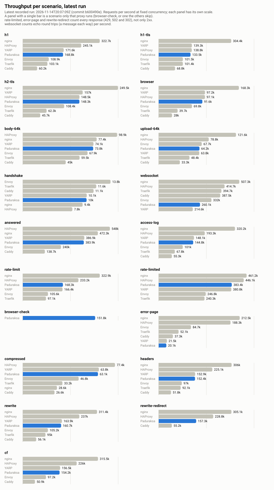
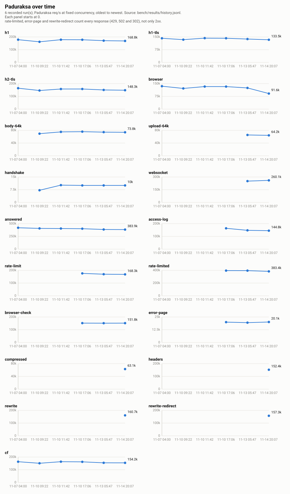
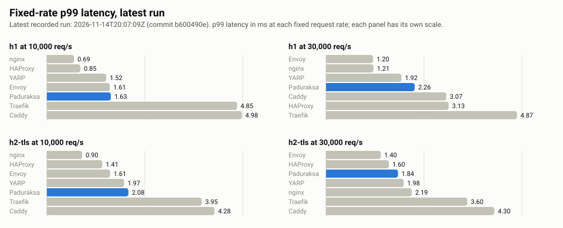

# Benchmark results

Generated by `bench/history.py report` from `bench/results/history.jsonl`, tables and SVG charts alike. Method, fairness rules and caveats: [bench/README.md](README.md). Runs are recorded with `RECORD=1 bench/run-baseline.sh`; only `summary.md`, `summary.json` and `env.txt` are committed per run.

6 recorded run(s).

## Latest run

2026-11-14T20:07:09Z · commit `b600490e` · 13th Gen Intel(R) Core(TM) i5-13600K · 20 logical CPUs · CPU sets: proxy 0-3, load 4-11, upstream 12-19.

### Throughput at fixed concurrency (successful requests/s)

| Scenario | Paduraksa | nginx | Caddy | HAProxy | Traefik | Envoy | YARP | Paduraksa ÷ nginx |
|---|---:|---:|---:|---:|---:|---:|---:|---:|
| h1 | 168,782 | **322,706** | 60,152 | 245,055 | 103,102 | 108,897 | 171,595 | 0.52 |
| h1-tls | 133,543 | **304,431** | 68,819 | 138,756 | 101,424 | 101,467 | 139,298 | 0.44 |
| h2-tls | 148,311 | **249,543** | 45,703 | 148,457 | 62,255 | 108,374 | 156,991 | 0.59 |
| browser | 91,616 | **168,252** | 27,990 | 97,052 | 39,701 | 69,780 | 97,156 | 0.54 |
| body-64k | 73,795 | 77,446 | 44,996 | **98,931** | 59,521 | 67,895 | 74,094 | 0.95 |
| upload-64k | 64,174 | **121,629** | 33,317 | 78,759 | 48,413 | 67,749 | 63,828 | 0.53 |
| handshake | 10,028 | 9,405 | 11,131 | 7,793 | 11,553 | **13,796** | 10,058 | 1.07 |
| websocket | 260,131 | **507,318** | 387,463 | 414,735 | 394,679 | 331,975 | 214,590 | 0.51 |
| answered | 383,897 | 472,334 | 138,689 | **548,025** | - | 239,975 | 386,949 | 0.81 |
| access-log | 144,775 | **320,174** | 55,271 | 193,301 | 67,822 | 100,960 | 148,147 | 0.45 |
| rate-limit | 168,281 | **322,888** | - | 233,219 | 97,150 | 105,625 | 166,449 | 0.52 |
| rate-limited | 383,363 | **461,236** | - | 446,066 | 240,292 | 246,774 | 380,846 | 0.83 |
| browser-check | 151,798 | - | - | - | - | - | - | - |
| error-page | 20,101 | **212,454** | 37,289 | 188,347 | 52,137 | 84,685 | 21,502 | 0.09 |
| compressed | 63,067 | 28,641 | 26,586 | **77,352** | 33,225 | 46,845 | 63,806 | 2.20 |
| headers | 152,442 | **306,031** | 51,791 | 225,059 | 92,132 | 96,984 | 152,894 | 0.50 |
| rewrite | 160,689 | **311,378** | 56,145 | 237,028 | 95,021 | 105,197 | 163,912 | 0.52 |
| rewrite-redirect | 157,341 | **305,107** | 55,179 | 228,797 | - | - | - | 0.52 |
| cf | 154,205 | **315,477** | 50,885 | 225,981 | - | 97,184 | 156,466 | 0.49 |

`rate-limited`, `error-page` and `rewrite-redirect` count every response (429, 502 and 302), not only 2xx: for those rows the number is what the proxy refused or failed, and their `errors` column is the same count.

`websocket` counts echo round trips (a message each way), not requests.

### Latency at fixed concurrency (ms)

| Scenario | Proxy | req/s | p50 | p99 | p99.9 | errors |
|---|---|---:|---:|---:|---:|---:|
| h1 | Paduraksa | 168,782 | 0.37 | 0.78 | 1.87 | 0 |
| h1 | nginx | **322,706** | **0.21** | **0.27** | **0.30** | 0 |
| h1 | Caddy | 60,152 | 0.81 | 3.70 | 4.60 | 0 |
| h1 | HAProxy | 245,055 | 0.25 | 0.38 | 0.39 | 0 |
| h1 | Traefik | 103,102 | 0.50 | 3.01 | 4.22 | 0 |
| h1 | Envoy | 108,897 | 0.58 | 0.76 | 0.79 | 0 |
| h1 | YARP | 171,595 | 0.36 | 0.78 | 2.16 | 0 |
| h1-tls | Paduraksa | 133,543 | 0.46 | 1.08 | 2.66 | 0 |
| h1-tls | nginx | **304,431** | **0.19** | **0.28** | **0.30** | 0 |
| h1-tls | Caddy | 68,819 | 0.71 | 3.33 | 4.37 | 0 |
| h1-tls | HAProxy | 138,756 | 0.46 | 0.60 | 0.66 | 0 |
| h1-tls | Traefik | 101,424 | 0.51 | 3.04 | 4.31 | 0 |
| h1-tls | Envoy | 101,467 | 0.62 | 0.97 | 1.00 | 0 |
| h1-tls | YARP | 139,298 | 0.44 | 0.94 | 2.20 | 0 |
| h2-tls | Paduraksa | 148,311 | 0.41 | 1.01 | 1.47 | 0 |
| h2-tls | nginx | **249,543** | **0.28** | **0.37** | **0.40** | 0 |
| h2-tls | Caddy | 45,703 | 1.21 | 3.96 | 5.02 | 0 |
| h2-tls | HAProxy | 148,457 | 0.43 | 0.56 | 0.65 | 0 |
| h2-tls | Traefik | 62,255 | 0.90 | 3.58 | 4.79 | 0 |
| h2-tls | Envoy | 108,374 | 0.62 | 0.94 | 1.01 | 0 |
| h2-tls | YARP | 156,991 | 0.39 | 0.93 | 1.42 | 0 |
| browser | Paduraksa | 91,616 | 0.50 | 1.18 | 1.79 | 305251 |
| browser | nginx | **168,252** | **0.28** | **0.48** | **0.51** | 560225 |
| browser | Caddy | 27,990 | 1.48 | 4.70 | 5.82 | 92773 |
| browser | HAProxy | 97,052 | 0.49 | 0.65 | 0.76 | 322565 |
| browser | Traefik | 39,701 | 1.05 | 4.20 | 5.50 | 133099 |
| browser | Envoy | 69,780 | 0.78 | 1.59 | 1.72 | 231707 |
| browser | YARP | 97,156 | 0.47 | 1.11 | 1.63 | 323018 |
| body-64k | Paduraksa | 73,795 | 0.85 | 1.54 | 2.64 | 0 |
| body-64k | nginx | 77,446 | 0.83 | 0.99 | **1.05** | 0 |
| body-64k | Caddy | 44,996 | 1.02 | 5.51 | 7.08 | 0 |
| body-64k | HAProxy | **98,931** | **0.64** | **0.88** | 1.90 | 0 |
| body-64k | Traefik | 59,521 | 0.92 | 4.03 | 5.83 | 0 |
| body-64k | Envoy | 67,895 | 0.91 | 1.25 | 1.40 | 0 |
| body-64k | YARP | 74,094 | 0.85 | 1.51 | 2.43 | 0 |
| upload-64k | Paduraksa | 64,174 | 0.98 | 1.70 | 2.83 | 0 |
| upload-64k | nginx | **121,629** | **0.52** | **0.81** | 1.97 | 0 |
| upload-64k | Caddy | 33,317 | 1.52 | 5.73 | 8.13 | 0 |
| upload-64k | HAProxy | 78,759 | 0.82 | 0.91 | 3.50 | 0 |
| upload-64k | Traefik | 48,413 | 1.01 | 5.15 | 6.78 | 0 |
| upload-64k | Envoy | 67,749 | 0.95 | 1.30 | **1.37** | 0 |
| upload-64k | YARP | 63,828 | 0.98 | 1.69 | 2.95 | 0 |
| handshake | Paduraksa | 10,028 | 1.55 | **2.64** | 3.87 | 0 |
| handshake | nginx | 9,405 | 1.59 | 4.03 | 4.77 | 0 |
| handshake | Caddy | 11,131 | 1.32 | 3.64 | 4.65 | 0 |
| handshake | HAProxy | 7,793 | 2.04 | 2.67 | **3.01** | 0 |
| handshake | Traefik | 11,553 | 1.26 | 3.98 | 5.41 | 0 |
| handshake | Envoy | **13,796** | **1.01** | 2.78 | 3.18 | 0 |
| handshake | YARP | 10,058 | 1.54 | 2.66 | 3.96 | 0 |
| websocket | Paduraksa | 260,131 | 0.22 | 0.58 | 1.22 | 0 |
| websocket | nginx | **507,318** | **0.11** | 0.43 | 0.91 | 0 |
| websocket | Caddy | 387,463 | 0.15 | 0.56 | 1.40 | 0 |
| websocket | HAProxy | 414,735 | 0.14 | 0.48 | **0.86** | 0 |
| websocket | Traefik | 394,679 | 0.14 | 0.57 | 1.28 | 0 |
| websocket | Envoy | 331,975 | 0.18 | **0.36** | 0.87 | 0 |
| websocket | YARP | 214,590 | 0.25 | 0.73 | 1.29 | 0 |
| answered | Paduraksa | 383,897 | 0.15 | 0.55 | 2.38 | 0 |
| answered | nginx | 472,334 | 0.14 | **0.17** | **0.22** | 0 |
| answered | Caddy | 138,689 | 0.31 | 2.57 | 3.62 | 0 |
| answered | HAProxy | **548,025** | **0.11** | 0.22 | 0.23 | 0 |
| answered | Envoy | 239,975 | 0.27 | 0.35 | 0.44 | 0 |
| answered | YARP | 386,949 | 0.16 | 0.43 | 2.22 | 0 |
| access-log | Paduraksa | 144,775 | 0.39 | 1.39 | 2.81 | 0 |
| access-log | nginx | **320,174** | **0.19** | **0.27** | **0.29** | 0 |
| access-log | Caddy | 55,271 | 0.88 | 4.18 | 9.19 | 0 |
| access-log | HAProxy | 193,301 | 0.33 | 0.45 | 0.51 | 0 |
| access-log | Traefik | 67,822 | 0.65 | 4.80 | 7.05 | 0 |
| access-log | Envoy | 100,960 | 0.60 | 1.27 | 1.34 | 0 |
| access-log | YARP | 148,147 | 0.41 | 0.91 | 1.90 | 0 |
| rate-limit | Paduraksa | 168,281 | 0.37 | 0.86 | 1.98 | 0 |
| rate-limit | nginx | **322,888** | **0.19** | **0.30** | **0.32** | 0 |
| rate-limit | HAProxy | 233,219 | 0.26 | 0.40 | 0.45 | 0 |
| rate-limit | Traefik | 97,150 | 0.53 | 3.21 | 4.53 | 0 |
| rate-limit | Envoy | 105,625 | 0.58 | 0.93 | 0.97 | 0 |
| rate-limit | YARP | 166,449 | 0.37 | 0.82 | 1.93 | 0 |
| rate-limited | Paduraksa | 383,363 | 0.16 | 0.49 | 2.12 | 3834571 |
| rate-limited | nginx | **461,236** | 0.14 | **0.18** | **0.22** | 4613120 |
| rate-limited | HAProxy | 446,066 | **0.13** | 0.27 | 0.28 | 4461843 |
| rate-limited | Traefik | 240,292 | 0.19 | 1.39 | 3.84 | 2403674 |
| rate-limited | Envoy | 246,774 | 0.28 | 0.33 | 0.43 | 2468452 |
| rate-limited | YARP | 380,846 | 0.16 | 0.44 | 2.11 | 3809098 |
| browser-check | Paduraksa | 151,798 | 0.41 | 0.86 | 1.48 | 0 |
| error-page | Paduraksa | 20,101 | 3.04 | 6.95 | 9.70 | 201029 |
| error-page | nginx | **212,454** | **0.30** | 0.41 | 0.47 | 2125101 |
| error-page | Caddy | 37,289 | 1.36 | 5.82 | 7.35 | 372941 |
| error-page | HAProxy | 188,347 | 0.34 | **0.40** | **0.45** | 1883910 |
| error-page | Traefik | 52,137 | 1.02 | 4.57 | 5.93 | 521460 |
| error-page | Envoy | 84,685 | 0.69 | 1.19 | 1.22 | 847070 |
| error-page | YARP | 21,502 | 2.89 | 5.99 | 8.80 | 215089 |
| compressed | Paduraksa | 63,067 | 1.00 | 1.72 | 2.35 | 0 |
| compressed | nginx | 28,641 | 2.46 | 2.76 | 2.90 | 0 |
| compressed | Caddy | 26,586 | 2.07 | 7.44 | 9.97 | 0 |
| compressed | HAProxy | **77,352** | **0.82** | **0.90** | **1.06** | 0 |
| compressed | Traefik | 33,225 | 1.69 | 5.92 | 8.22 | 0 |
| compressed | Envoy | 46,845 | 1.48 | 2.17 | 2.30 | 0 |
| compressed | YARP | 63,806 | 0.98 | 1.74 | 2.56 | 0 |
| headers | Paduraksa | 152,442 | 0.40 | 0.93 | 2.19 | 0 |
| headers | nginx | **306,031** | **0.21** | **0.29** | 0.76 | 0 |
| headers | Caddy | 51,791 | 0.94 | 4.49 | 5.55 | 0 |
| headers | HAProxy | 225,059 | 0.27 | 0.40 | **0.64** | 0 |
| headers | Traefik | 92,132 | 0.56 | 3.27 | 4.61 | 0 |
| headers | Envoy | 96,984 | 0.67 | 0.91 | 0.94 | 0 |
| headers | YARP | 152,894 | 0.40 | 0.89 | 2.20 | 0 |
| rewrite | Paduraksa | 160,689 | 0.38 | 0.90 | 2.11 | 0 |
| rewrite | nginx | **311,378** | **0.20** | **0.24** | **0.28** | 0 |
| rewrite | Caddy | 56,145 | 0.86 | 4.25 | 5.31 | 0 |
| rewrite | HAProxy | 237,028 | 0.26 | 0.39 | 0.48 | 0 |
| rewrite | Traefik | 95,021 | 0.54 | 3.24 | 4.50 | 0 |
| rewrite | Envoy | 105,197 | 0.58 | 0.99 | 1.03 | 0 |
| rewrite | YARP | 163,912 | 0.37 | 0.85 | 2.25 | 0 |
| rewrite-redirect | Paduraksa | 157,341 | 0.39 | 0.93 | 1.96 | 1573694 |
| rewrite-redirect | nginx | **305,107** | **0.21** | **0.26** | **0.28** | 3051658 |
| rewrite-redirect | Caddy | 55,179 | 0.87 | 4.36 | 5.48 | 551916 |
| rewrite-redirect | HAProxy | 228,797 | 0.27 | 0.41 | 0.44 | 2288423 |
| cf | Paduraksa | 154,205 | 0.39 | 0.95 | 2.47 | 0 |
| cf | nginx | **315,477** | **0.23** | **0.30** | **0.33** | 0 |
| cf | Caddy | 50,885 | 0.99 | 3.82 | 4.76 | 0 |
| cf | HAProxy | 225,981 | 0.27 | 0.41 | 0.42 | 0 |
| cf | Envoy | 97,184 | 0.59 | 1.11 | 1.16 | 0 |
| cf | YARP | 156,466 | 0.39 | 0.93 | 2.42 | 0 |

## Charts

### Latest run, throughput per scenario

### Paduraksa over time

### Fixed-rate p99 latency

## Paduraksa trend per commit

Throughput and p99 at fixed concurrency, with the ratio to nginx from the same run.

| Date | Commit | h1 req/s | h1 p99 | h1 ÷ nginx | h2-tls req/s | h2-tls p99 | h2-tls ÷ nginx |
|---|---|---:|---:|---:|---:|---:|---:|
| 2026-11-07T04:00:33Z | `57e3c8a9`* | 178,734 | 0.73 | 0.57 | 164,249 | 0.97 | 0.71 |
| 2026-11-10T09:22:48Z | `b6a7979a` | 161,923 | 0.90 | 0.50 | 146,099 | 1.07 | 0.61 |
| 2026-11-10T11:42:41Z | `e9ea546f` | 178,585 | 0.73 | 0.54 | 157,865 | 0.95 | 0.63 |
| 2026-11-10T17:06:32Z | `ba02cad5` | 178,206 | 0.80 | 0.55 | 157,976 | 1.05 | 0.64 |
| 2026-11-13T05:47:39Z | `98ccf765` | 171,033 | 0.80 | 0.53 | 150,430 | 1.03 | 0.61 |
| 2026-11-14T20:07:09Z | `b600490e` | 168,782 | 0.78 | 0.52 | 148,311 | 1.01 | 0.59 |

`*` marks a run from a dirty tree.

## Change since the previous run

| Scenario | Rate | Metric | Previous | Latest | Change | |
|---|---:|---|---:|---:|---:|---|
| h1 | - | req/s | 171,033 | 168,782 | -1.3% |  |
| h1 | 10,000 | p99 ms | 1.34 | 1.63 | +21.7% |  |
| h1 | 30,000 | p99 ms | 2.48 | 2.26 | -8.6% |  |
| h1-tls | - | req/s | 137,827 | 133,543 | -3.1% |  |
| h2-tls | - | req/s | 150,430 | 148,311 | -1.4% |  |
| h2-tls | 10,000 | p99 ms | 2.07 | 2.08 | +0.4% |  |
| h2-tls | 30,000 | p99 ms | 1.85 | 1.84 | -0.7% |  |
| browser | - | req/s | 124,759 | 91,616 | -26.6% | **possible regression** |
| body-64k | - | req/s | 74,281 | 73,795 | -0.7% |  |
| upload-64k | - | req/s | 65,421 | 64,174 | -1.9% |  |
| handshake | - | req/s | 10,038 | 10,028 | -0.1% |  |
| websocket | - | req/s | 251,423 | 260,131 | +3.5% |  |
| answered | - | req/s | 385,590 | 383,897 | -0.4% |  |
| access-log | - | req/s | 147,562 | 144,775 | -1.9% |  |
| rate-limit | - | req/s | 169,585 | 168,281 | -0.8% |  |
| rate-limited | - | req/s | 395,167 | 383,363 | -3.0% |  |
| browser-check | - | req/s | 151,396 | 151,798 | +0.3% |  |
| error-page | - | req/s | 19,462 | 20,101 | +3.3% |  |
| cf | - | req/s | 154,485 | 154,205 | -0.2% |  |
