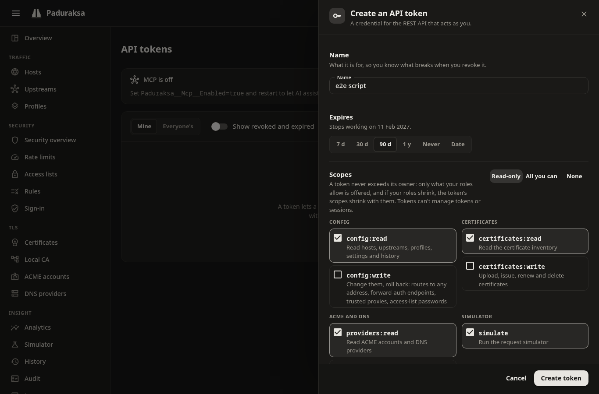

# The REST API

Everything the dashboard does, the REST API does, with the same permissions and the same audit trail. It is at `/api/v1` on the admin port, and it is described by an OpenAPI 3.1 document.

- [API reference](api-reference.md): every operation, rendered from the document this version ships.
- `https://<admin host>:9443/api/docs` on your own instance (an interactive reference), and `/api/v1/openapi.json` (the document).
- `GET /api/v1/version` names the product version, the API version (`v1`) and, for a container build, the commit.

## Authentication

A script authenticates with an **API token**: `Authorization: Bearer pdk_...`. Create one under **Settings**, **API tokens**.



- A token has a name, an optional expiry and **scopes**: permission names such as `config:read`. The drawer offers *Read-only*, *All you can* and *None* as starting points.
- A token never exceeds its owner. Its effective permissions are the intersection of its scopes and the owner's **current** permissions, checked on every use. Demote the owner and the token shrinks with them.
- The secret is shown once. Paduraksa stores only a hash. A revoked or expired token stops working at once.
- **A token cannot manage tokens or sessions.** Every `tokens` and `sessions` endpoint answers a token with `403`, so a leaked token cannot mint a longer life for itself.
- A token's `pdk_` prefix and checksum let secret scanners find a leaked one.

| Scope | Allows |
|---|---|
| `config:read`, `config:write` | Read or change hosts, routes, upstreams, profiles, rate limits, access lists, rules, sign-in providers, settings, drafts, revisions, import and rollback |
| `certificates:read`, `certificates:write` | The certificate inventory; add, issue, renew and delete certificates |
| `providers:read`, `providers:write` | ACME accounts, DNS providers and notification channels (never their secrets) |
| `users:read`, `users:write` | List users and roles; create, change and delete users |
| `tokens:own`, `tokens:all` | Your own tokens; every user's tokens |
| `sessions:all` | Every user's sessions |
| `audit:read` | The audit log |
| `vault:manage` | Secrets in the vault: store, replace, delete, never read |
| `simulate` | The request simulator |
| `logs:read` | The log files and the live tail |
| `metrics:read` | Counters, analytics and the Prometheus endpoint. Every role holds it |
| `backup:create` | A full backup. The Owner only |

Roles are sets of these. Owner holds everything. Admin holds config, certificates, providers, audit, simulate and the user list. Operator holds config, certificates, provider reads and simulate. Viewer reads and simulates. Auditor reads and holds audit. Only Owner holds `users:write`, `vault:manage`, `tokens:all`, `sessions:all` and `backup:create`.

A browser session (the dashboard's cookie) also works, but then every unsafe request must say where it comes from: send `Origin`. A token needs none of that.

## Trust the admin certificate

The admin port's certificate is signed by Paduraksa's local CA. Give `curl` the root:

```sh
curl -k -o root.pem https://paduraksa.lan:9443/api/v1/ca/root.pem     # once, then check its fingerprint
curl --cacert root.pem -H "Authorization: Bearer $TOKEN" https://paduraksa.lan:9443/api/v1/hosts
```

Check the fingerprint against `GET /api/v1/ca` or the Local CA page before you trust a root you fetched with `-k`.

## Conventions

- **Paths** are kebab-case and collections are plural: `/api/v1/rate-limit-policies/{id}`. An action on an object is `POST /{collection}/{id}/{verb}`, such as `/certificates/{id}/renew`.
- **JSON** members are camelCase. IDs are typed strings (`host_...`, `ups_...`, `rte_...`). Times are ISO 8601 in UTC. Enums are strings.
- **Statuses.** A create is `POST` to the collection: `201`. A change is `PUT` (replace) or `PATCH`: `200`. A delete is `204`.
- **Errors** are RFC 9457 problem details (`application/problem+json`) with a `traceId` and a stable dotted `code` such as `host.name.duplicate`. A validation failure is `422` with an `errors` list of `{ path, code, message }`.

### IDs are yours to choose

A create needs an `id`: a typed string, the prefix and an underscore, then 22 base-62 characters (`^host_[0-9A-Za-z]{22}$`). Use a time-ordered one, such as a UUIDv7 written in base 62 (the digits `0-9A-Za-z`, in that order). This script makes one:

```python
import os, sys, time
ALPHABET = "0123456789ABCDEFGHIJKLMNOPQRSTUVWXYZabcdefghijklmnopqrstuvwxyz"

def new_id(prefix):
    ms = int(time.time() * 1000)
    n = (ms << 80) | (0x7 << 76) | ((int.from_bytes(os.urandom(2)) & 0xFFF) << 64) | (0b10 << 62) | (int.from_bytes(os.urandom(8)) & ((1 << 62) - 1))
    digits = ""
    while n:
        n, r = divmod(n, 62)
        digits = ALPHABET[r] + digits
    return f"{prefix}_{digits.rjust(22, '0')}"

print(new_id(sys.argv[1]))   # python3 new-id.py host  ->  host_034wzZoNpxm3a53aJxIOBE
```

When you only want to describe the config and not mint IDs, use [YAML import](../operating/export-import.md): an object without an `id` is matched by name or created.

### Pagination

Every collection answers `{ "items": [...], "nextCursor": "..." }` and takes `limit` (1 to 200, default 50) and `cursor` (what the previous page gave, opaque). `nextCursor` is `null` on the last page.

- Config and provider collections are ascending by ID.
- History (revisions, audit, notification history) is newest first.
- The exceptions are the log files (a directory listing), the recent access log (a bounded snapshot with `limit` up to 1000 and no cursor) and the upstreams' live health.

```sh
curl --cacert root.pem -H "Authorization: Bearer $TOKEN" "https://paduraksa.lan:9443/api/v1/hosts?limit=50"
```

### Changing config: `If-Match`, `dryRun` and `message`

Config objects (hosts, routes, upstreams, profiles, rate limits, access lists, rule sets, sign-in providers, the settings) carry a `version`.

- A `GET` answers with `ETag: "<version>"`. A change or delete of that object sends it back in `If-Match`, as one quoted tag. Without it the answer is `428`. A stale tag is `412`, and the problem's `conflict` says what is current. A malformed tag, a list or `*` is `400`. A create needs none.
- A route belongs to its host: changing or deleting a route takes the host's version in `If-Match`.
- `POST /revisions/{id}/rollback` and `POST /config/import` take the latest revision's ID the same way.
- `?dryRun=true` runs the whole command and returns the plan (`status: "dryRun"`, the warnings and the changes) without committing.
- `?message=` is the revision's note, up to 1000 characters.
- `?force=true` overrides the lock-out guard for the admin host.
- A change that was stored but could not go live is `500` with `code: config.publishFailed`, the stored `revision` and the new `ETag`.
- Certificates, ACME accounts, DNS providers, notification channels, users and tokens carry no version: a change overwrites, and last write wins.

A change answers with its result: `status` (`committed` or `dryRun`), the `revision`, the `publish` outcome, the new `version`, `warnings` and `changes`.

### Example: a service behind a host

```sh
A=https://paduraksa.lan:9443/api/v1
H="Authorization: Bearer $TOKEN"
UPS=$(python3 new-id.py ups); DST=$(python3 new-id.py dst); HOST=$(python3 new-id.py host); RTE=$(python3 new-id.py rte)

curl --cacert root.pem -H "$H" -H 'Content-Type: application/json' -X POST "$A/upstreams" -d "{
  \"id\": \"$UPS\", \"name\": \"jellyfin\",
  \"destinations\": [{ \"id\": \"$DST\", \"address\": \"http://jellyfin:8096\" }]
}"

BODY="{
  \"id\": \"$HOST\", \"names\": [\"jellyfin.example.com\"],
  \"routes\": [{ \"id\": \"$RTE\", \"upstreamId\": \"$UPS\", \"match\": \"prefix\", \"path\": \"/\" }]
}"
curl --cacert root.pem -H "$H" -H 'Content-Type: application/json' -X POST "$A/hosts?dryRun=true" -d "$BODY"             # the plan
curl --cacert root.pem -H "$H" -H 'Content-Type: application/json' -X POST "$A/hosts?message=add+jellyfin" -d "$BODY"    # for real
```

To change it later, read it, send it back with the version:

```sh
curl --cacert root.pem -D - -H "$H" "$A/hosts/$HOST" -o host.json          # ETag: "2"
# edit host.json ...
curl --cacert root.pem -H "$H" -H 'If-Match: "2"' -H 'Content-Type: application/json' -X PUT "$A/hosts/$HOST" -d @host.json
```

### Request bodies

JSON bodies are limited to 64 KiB by default (`Paduraksa__Admin__MaxRequestBodyBytes`). A certificate upload and a config import raise their own limits. Bodies are strict: an unknown member is an error.

### Drafts

`/api/v1/drafts` is the draft the dashboard shows. A token acts on its owner's draft: add entries with `POST /drafts/{id}/entries`, review with `POST /drafts/{id}/review` and apply with `POST /drafts/{id}/apply` with the review's token in `If-Match`. If the config changed since, apply is refused with `412` and `draft.changedSinceReview`, and the fresh review comes back. See [Hosts and routes](../guide/hosts-and-routes.md#drafts).

## Streams and files

- `GET /api/v1/logs/tail` streams requests as they end as Server-Sent Events: `curl -N -H "$H" "$A/logs/tail?statusClass=5xx&backlog=50"`.
- `GET /api/v1/logs/{name}` downloads a log file, and `POST /api/v1/backup` makes a [backup](../operating/backups.md).
- `GET /metrics` (the same as `/api/v1/metrics`) is the Prometheus text format: see [Metrics](../guide/observability.md#metrics).
