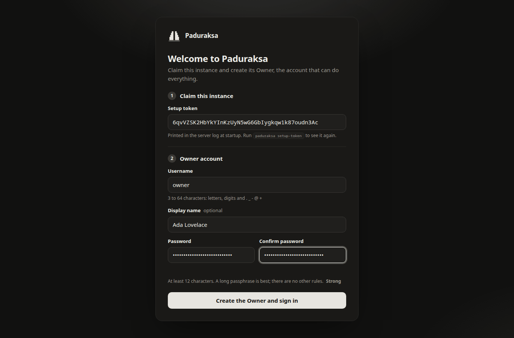
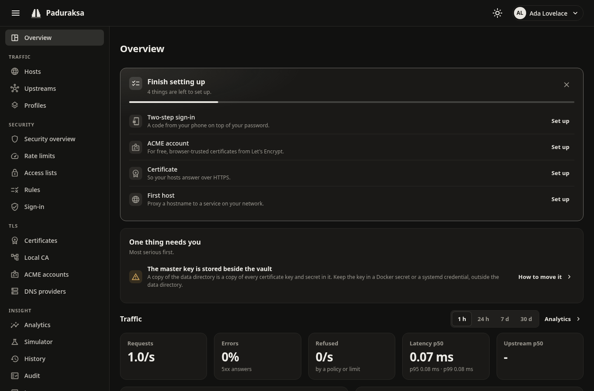
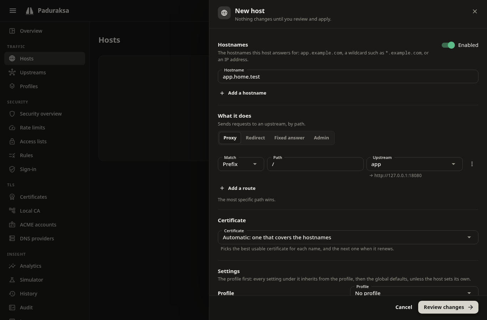
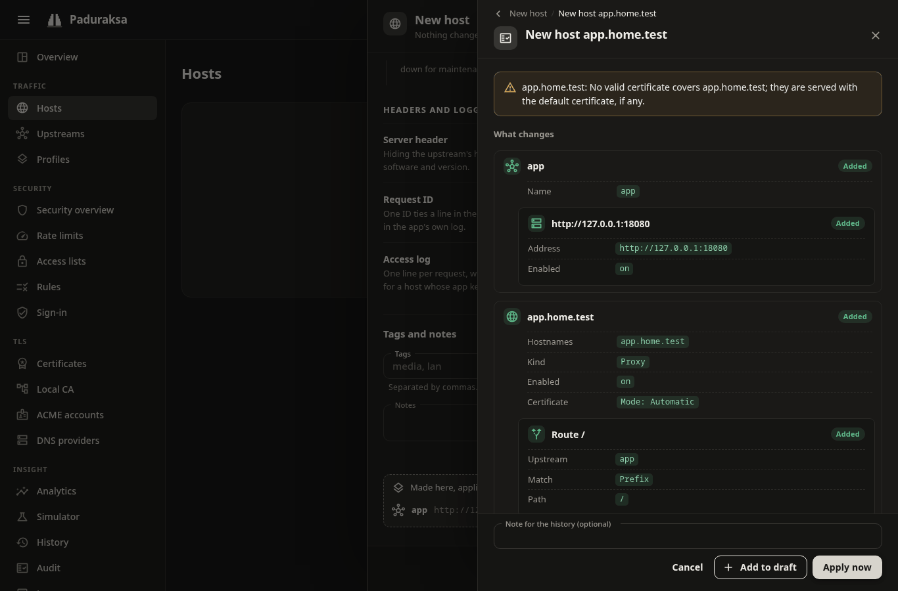

# Getting started

This page takes you from nothing to one service behind Paduraksa with HTTPS. It needs Docker 20.10 or later with Compose v2.

Paduraksa v0.1 is a single node: one process, one data directory and three listeners.

| Port | Used for |
|---|---|
| 80/tcp | HTTP, ACME HTTP-01 challenges, redirects to HTTPS |
| 443/tcp | HTTP/1.1 and HTTP/2 |
| 443/udp | HTTP/3 |
| 9443/tcp | The admin app: dashboard, REST API and, if you turn it on, MCP |

## 1. Start it

Put [`deploy/compose.yaml`](https://github.com/hizkifw/paduraksa/blob/main/deploy/compose.yaml) in a directory of its own and create the master key beside it:

```sh
mkdir paduraksa && cd paduraksa
curl -fsSLO https://raw.githubusercontent.com/hizkifw/paduraksa/main/deploy/compose.yaml
head -c 32 /dev/urandom | base64 | sudo install -m 400 -o 10001 -g 10001 /dev/stdin master.key
docker compose up -d
```

- The compose file runs `ghcr.io/hizkifw/paduraksa:main`, which CI publishes from every commit on `main` that passes, for amd64 and arm64.
- `master.key` opens the vault, which holds every certificate key, DNS credential and TOTP secret. Compose refuses to start without the file.
- **Copy `master.key` somewhere other than this machine now.** Nothing else opens the vault. See [The master key](../operating/master-key.md).
- The ports are mapped one to one on purpose. Do not remap them: `Alt-Svc` and the HTTP to HTTPS redirect advertise 443.

[Running with Docker](../operating/docker.md) covers building the image yourself, bind-mounted data and the container hardening.

## 2. Read the setup token

On its first start Paduraksa prints a boxed banner with a one-time token that creates the first Owner. The token is also written to `/data/setup-token`.

```sh
docker logs paduraksa 2>&1 | grep -A8 "Paduraksa first-run setup"
# or, at any time before setup completes:
docker compose exec paduraksa paduraksa setup-token
```

The token is single-use. Paduraksa deletes it once an Owner exists.

## 3. Trust the local CA root (optional)

The admin port is HTTPS only, and its certificate comes from Paduraksa's own local CA. Until your browser trusts the CA's root, you get a certificate warning.

The compose file publishes the admin port on loopback only. Open it on the server itself, or from your machine through an SSH tunnel:

```sh
ssh -L 9443:127.0.0.1:9443 you@server
```

To open it on your LAN instead, see [Exposing the admin port](../operating/admin-access.md).

The root is served before setup, so you can trust it first:

```sh
curl -k -o paduraksa.crt https://localhost:9443/api/v1/ca/root.pem      # PEM: Linux and macOS trust stores
curl -k -o paduraksa-root.crt https://localhost:9443/api/v1/ca/root.crt # DER: Android and iOS offer to install it
curl -k https://localhost:9443/api/v1/ca                                # fingerprint, subject and validity as JSON
```

- `-k` is needed only because the certificate is not trusted yet.
- Linux: `sudo cp paduraksa.crt /usr/local/share/ca-certificates/paduraksa.crt && sudo update-ca-certificates`. `update-ca-certificates` reads PEM and ignores a DER file, so keep the `.crt` name on the PEM.
- macOS: add it to the System keychain and mark it trusted.
- Windows: import it into *Trusted Root Certification Authorities*.

## 4. Create the Owner and sign in

Open `https://localhost:9443/` (or `https://<host>:9443/`). The setup page asks for:

- the setup token;
- a username (3 to 64 characters: letters, digits and `. _ - @ +`);
- a password of at least 12 characters. There are no composition rules, so a long passphrase is best.



You land on the Overview, whose **Finish setting up** checklist lists what is left: two-step sign-in, an ACME account, a certificate and a first host.



!!! tip
    Set up two-step sign-in (TOTP) from **My account** now. It is optional, and nothing forces it, but every Owner and Admin should have one. The dashboard shows ten recovery codes once. Keep them.

A plain `http://<host>:9443/` request is answered with a redirect to the same URL over `https://`. No page is ever served over plain HTTP.

## 5. Put a service behind it

A **host** answers for one or more names. A **route** on it sends a path to an **upstream**, which is a set of destinations. The next steps use a service at `http://jellyfin:8096` as the example.

### Get a certificate

1. Open **ACME accounts** (TLS) and add one. Pick **Let's Encrypt**, optionally give a contact email, and agree to the CA's terms. Try **Let's Encrypt (staging)** first if you are unsure: its limits are generous and no browser trusts its certificates.
2. Open **Certificates**, then **Add certificate**, then **From an ACME CA**. Enter the hostname (`jellyfin.example.com`), pick the account and a challenge:
    - **HTTP-01** needs port 80 of the hostname reachable from the internet. It cannot issue wildcards.
    - **DNS-01** needs a DNS provider (Cloudflare or deSEC) and nothing reachable. It issues wildcards.
3. Watch the progress. Issuance continues in the background if you close the dialog.

For a name that only exists on your LAN, a public CA cannot validate it. Use **From the local CA** instead. See [TLS and certificates](tls.md).

### Add the host

1. Open **Hosts** and choose **Add host**.
2. Enter the hostname.
3. Under **What it does** keep **Proxy**. In the route, keep **Prefix** and the path `/`, and for **Upstream** choose **New upstream...**. Name it and give it the destination `http://jellyfin:8096`.
4. Leave **Certificate** on *Automatic*, which picks a certificate that covers the hostname.
5. Choose **Review changes**.



The review sheet shows exactly what will change, with the compiler's warnings. A warning that no valid certificate covers the name means step 1 is not finished.



Choose **Apply now**. The change goes live in milliseconds without dropping requests, and the toast offers **Undo**.

Every config change goes through this review. [Hosts and routes](hosts-and-routes.md) explains drafts, which collect changes made on several pages and apply them as one revision.

### Check it

```sh
curl -I https://jellyfin.example.com/
```

The public listeners answer as soon as a host matches. The admin certificate never serves proxied traffic.

!!! note
    The host's DNS record must point at the machine that runs Paduraksa. To test before changing DNS, use `curl --resolve jellyfin.example.com:443:<server ip> https://jellyfin.example.com/`. The **Simulator** (Insight) also answers "why was this routed, redirected or refused" for any request, against the live config or a draft.

## Where next

- [Hosts and routes](hosts-and-routes.md): redirect and fixed-answer hosts, profiles, settings layers, maintenance mode.
- [Upstreams](upstreams.md): several destinations, health checks, timeouts, HTTPS upstreams.
- [Access control and WAF](security.md): lock a host to your LAN, add sign-in, rate limits.
- [Backups and restore](../operating/backups.md): make one before you rely on it.
