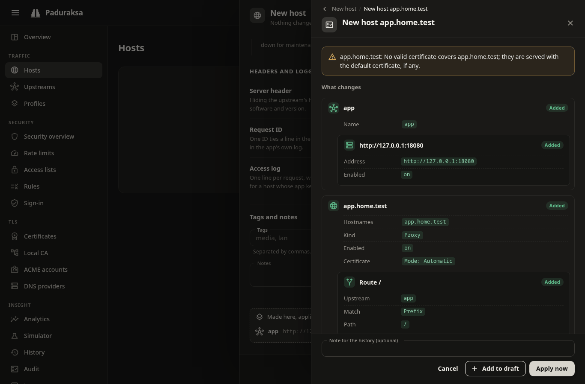
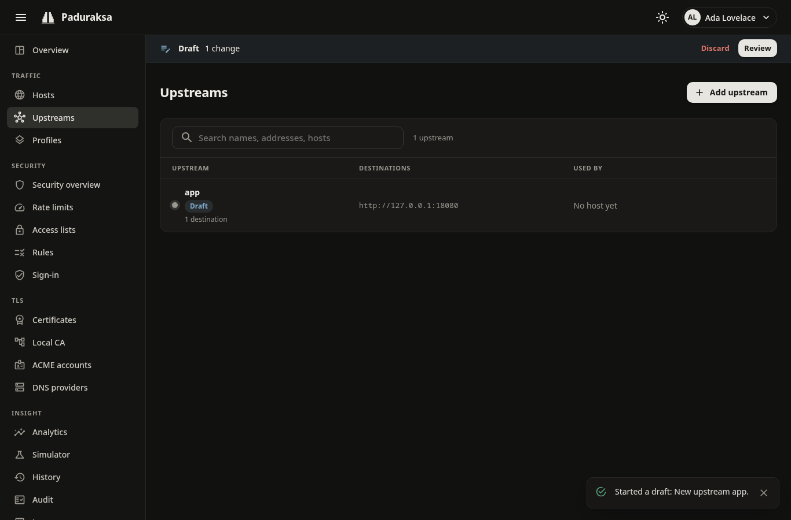
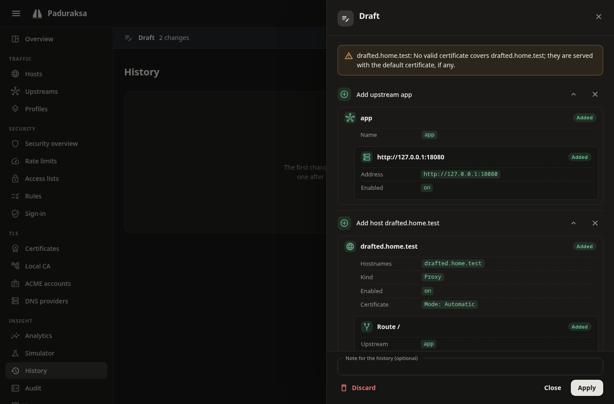

# Hosts and routes

A **host** is a set of names and what Paduraksa does with requests for them. A proxy host also has **routes**, each sending a path to an upstream. Settings (HTTPS, HSTS, access lists, limits and the rest) are layered, so you state a rule once and hosts inherit it.

## Host kinds

| Kind | In the dashboard | What it does |
|---|---|---|
| Proxy | Proxy | Forwards requests to an upstream, by path. Needs at least one route. |
| Redirect | Redirect | Answers with a redirect to a fixed target. |
| Respond | Fixed answer | Answers with a fixed status and body: a 404, a 410, "coming soon". |
| Admin | Admin | Serves the admin app itself through the proxy. See [Exposing the admin port](../operating/admin-access.md). |

Static file serving is not in v0.1.

### Names

A host's names are exact names (`app.example.com`), wildcards (`*.example.com`) or IP addresses.

- Names are normalised when saved: trimmed, lowercased, internationalised names converted to punycode.
- A name has at most 253 characters, each label at most 63. A wildcard is only the leftmost label, and there is no trailing dot.
- A name is unique across enabled hosts, ignoring case. A disabled host keeps its names without serving them, so they may repeat an enabled host's.

A request for a name no enabled host serves gets the global **unknown host** behaviour: `404` (the default), `421 Misdirected Request`, or the connection closed. Set it under **Global defaults**.

### Redirect hosts

- **Target:** an absolute `http` or `https` URL.
- **Status:** 301 (the default), 302, 303, 307 or 308.
- **Preserve path:** on by default. The request's path and query are appended to the target, so the target has no query or fragment of its own.

### Fixed-answer hosts

- **Status:** 200 to 599. 204, 205 and 304 have no body.
- **Body:** sent as UTF-8.
- **Content type:** `text/plain; charset=utf-8` unless you set one.

## Routes

A route has a **match**, a **path** and an **upstream**.

- **Match:** *Exact* matches that path only. *Prefix* matches the path and everything under it, by whole path segment (`/api` matches `/api/x`, not `/apix`).
- **Path:** starts with `/`, written decoded and canonical: no `\`, `//`, `;`, dot segments, percent-encoding, query or fragment. Matching ignores case, and two routes of a host with the same match kind cannot differ only in case.
- **Specificity:** the most specific route wins, whatever the list order. Exact routes come before prefixes, then a longer prefix before a shorter one, then the route's **Order** (lower first), then the listed order.

A request that matches no route gets a `404`.

Each route can carry a few overrides of its own: proof of work, rate limit, access list, rule set, sign-in provider, body size and custom headers. It can also rewrite the path it forwards (below). See [Access control and WAF](security.md) and [Connections, limits and client addresses](connections-and-limits.md).

### Rewriting the path

A route can forward a different path from the one the client asked for. Use it to put an app that expects to live at `/` under a path of a shared host, or to reach an API's versioned path. In the dashboard: the route's menu, **Route settings**, **Path sent upstream** and **Prefix to add**.

- **Strip the prefix:** the route's own path comes off. On `/grafana`, `/grafana/d/x` reaches Grafana as `/d/x`, and `/grafana` as `/`. Not on a route whose path is `/`.
- **Add a prefix:** a fixed path goes in front. With both on `/api` and `/v2`, `/api/users` reaches the API as `/v2/users`. The prefix starts with `/` and has no trailing `/`.
- The path is forwarded as the client sent it, without decoding or re-encoding (`%2F` stays `%2F`), and the query is untouched.
- A stripping route tells the upstream what it took off in `X-Forwarded-Prefix` (`/grafana`), so an app that builds its own links can add it back.
- **Redirects:** an upstream's `Location` under what the route sends gets the route's path back (`/login` reaches the client as `/grafana/login`). One that already starts with `/grafana`, from an app that reads `X-Forwarded-Prefix`, is left alone. An absolute `Location` on the name the upstream was sent gets the client's own scheme and host, so an internal address doesn't reach the browser.
- **Turn the mapping off** (**Redirects from the upstream**: *As the upstream sends them*, `rewriteLocation: false`) when the upstream redirects to other routes of the same host, such as oauth2-proxy sending `/oauth2/sign_in`: mapped, that would become `/grafana/oauth2/sign_in` and 404.
- **404 for a path that can't be rewritten without a guess:** a spelling of the prefix other than the route's own (`//grafana`, `/%67rafana`), and, on any rewritten route, a dot segment in any spelling (`..`, `%2e%2e`, `.%2E`, `..;`) or an escape a loose decoder could misread (`%25`, `%c0`, `%u`, control characters). Matching resolves dot segments first, but the path forwarded is the raw one, and the upstream would resolve it outside the prefix.

```yaml
upstreams:
  - name: grafana
    destinations:
      - address: http://grafana:3000
  - name: api
    destinations:
      - address: http://api:8080
hosts:
  - names: [home.example.com]
    routes:
      - path: /grafana
        upstream: grafana
        rewrite: {stripPrefix: true}
      - path: /api
        upstream: api
        rewrite: {stripPrefix: true, addPrefix: /v2, rewriteLocation: false}
```

## Custom headers

Rules set, add or remove a header on the request the upstream receives, or on the response the client receives. They are a host setting, so the global defaults, a profile, a host and a route can each carry some. In the dashboard: **Request headers** and **Response headers**, under *Headers and logging*.

- **Set** replaces every value the header had, **add** appends a value, **remove** takes the header off, whoever set it.
- **Layers merge by header name:** a rule for a name replaces the lower layer's rule for that name, and the other rules are kept. A route's rules go over its host's the same way. The form lists what a layer inherits and marks the rules it replaces.
- At most 32 rules per direction, per layer and after the layers merge. A name is up to 64 characters; a value is up to 4096 visible ASCII characters, with no line breaks and no leading or trailing space. Values are sent as written: there are no placeholders.
- **Response rules** go on the upstream's responses and on Paduraksa's own pages for the host (error pages, redirects, maintenance), after the built-in headers: a rule for `Server` wins over the **Server header** setting. A page's own `Content-Security-Policy` stays, whatever a rule says.
- **Refused names**, because Paduraksa sets them itself or they frame the message: `Connection`, `Content-Encoding`, `Content-Length`, `Expect`, `Keep-Alive`, `Proxy-Authenticate`, `Proxy-Authorization`, `Proxy-Connection`, `TE`, `Trailer`, `Transfer-Encoding` and `Upgrade` in both directions; `Host`, every `X-Forwarded-*`, `Forwarded`, `X-Real-IP`, `X-Request-Id`, every `cf-*`, `True-Client-IP` and `X-Paduraksa-Internal` on the request; `Strict-Transport-Security`, `Alt-Svc`, `X-Request-Id` and `Location` on the response. A request rule can't set a header a sign-in provider of the host vouches for, and a response `Set-Cookie` rule can only add.
- **Values are config, not secrets:** a static `Authorization` to an upstream is stored in the config and in its YAML export like any setting. The Simulator shows such values (`Authorization`, `Cookie`, names ending in `-Key`, `-Token` or `-Secret`) as redacted.

```yaml
profiles:
  - name: public
    settings:
      headers:
        response:
          - {name: X-Frame-Options, operation: set, value: DENY}
          - {name: X-Powered-By, operation: remove}
hosts:
  - names: [app.example.com]
    profile: public
    settings:
      headers:
        request:
          - {name: X-Tenant, operation: set, value: homelab}
    routes:
      - upstream: app
      - path: /embed
        upstream: app
        settings:
          headers:
            response:
              - {name: X-Frame-Options, operation: remove}   # replaces the profile's DENY for this route
```

## Compression

A host can compress the upstream's responses with Brotli or gzip, whichever the client's `Accept-Encoding` prefers. It is off until you turn it on, globally, per profile or per host (**Compress responses**, under *Compression*).

- It compresses text (HTML, CSS, JavaScript, JSON, XML, SVG, plain text, WebAssembly, fonts) whose declared size is at least **Smallest body** (1 KiB by default, 0 to 1 MiB). A body without a declared length is compressed.
- It leaves alone a response the upstream already compressed, a range, an event stream, a `Cache-Control: no-transform`, a `HEAD`, a WebSocket, and Paduraksa's own pages.
- A compressed response gets `Vary: Accept-Encoding`, a weak `ETag` (`W/"..."`, which still revalidates) and no `Content-Length` or `Accept-Ranges`.
- The access log and the metrics count the compressed bytes.

!!! warning "Compression and secrets (BREACH)"
    A page that shows a secret (a CSRF token, a session-bound value) next to text the request put there (a search term echoed back) leaks the secret through its compressed size to an attacker who can make a victim's browser send many requests. Paduraksa can't tell which pages do that, so compression is off by default. Leave it off for such hosts, or let the app compress what it knows is safe: a response the upstream already compressed passes through untouched.

```yaml
hosts:
  - names: [docs.example.com]
    settings:
      compression: {enabled: true, minimumSize: 512}
    routes:
      - upstream: docs
```

## Settings layers

Every host setting can be set at four layers. A layer that does not set a value inherits it from the one below.

1. **Built-in defaults.**
2. **Global defaults** (Settings, *Global defaults*): what every host inherits.
3. **Profile** (Traffic, *Profiles*): a named preset such as "LAN only" or "Media server". A host names at most one.
4. **Host:** the host's own overrides.
5. **Route:** only a few settings (the ones listed above, and custom headers), on top of the host's.

How layers combine:

- Each setting is either set or inherited. Grouped settings, such as HSTS, merge field by field: a layer can change `max-age` and keep the `includeSubDomains` below it.
- A rate limit, access list, rule set or sign-in provider that a lower layer applies can be lifted by turning it **off** at a higher layer. The choice of policy is kept while it is off.
- Error pages merge entry by entry, and each entry is replaced whole. Custom headers merge by header name.
- The dashboard shows where each value comes from ("inherited from Global", "from profile *LAN only*") and offers "override here" and "reset to inherited".

The settings a host can carry:

| Setting | Built-in default |
|---|---|
| HTTPS redirect (force HTTPS) | off |
| TLS: lowest version, TCP protocols, HTTP/3 | TLS 1.2, HTTP/2 and HTTP/1.1, HTTP/3 on |
| HSTS | off. Once on: one year, no subdomains, no preload |
| Access log | on |
| Request ID | sent upstream and back to the client |
| `Server` header | `Paduraksa`, with no version |
| Proof of work | off |
| Rate limit, access list, rules, sign-in provider | none |
| `robots.txt` | passed through to the upstream |
| Cloudflare: origin lockdown, Authenticated Origin Pulls | off |
| Request limits | 100 MiB body, 100 header lines, 32 KiB of headers, 8 KiB request target |
| Error pages | the built-in pages |
| Maintenance mode | off |
| Custom headers | none |
| Compression | off. Once on: from 1 KiB |

### HTTPS and HSTS

- **HTTPS redirect** redirects plain-HTTP requests to HTTPS before anything else. The redirect goes to the public HTTPS port (443, or `Paduraksa__Listen__PublicHttpsPort` behind a port mapping).
- A host with no certificate (**Certificate: None**) cannot force HTTPS.
- **HSTS** is sent only on HTTPS responses, and never for an IP address or a loopback name. A request for a name no host serves never carries it.
- `max-age` is 0 to 63 072 000 seconds (two years). 0 tells a browser to forget the host.
- `preload` needs `includeSubDomains` and a `max-age` of at least a year, and it is hard to undo: browsers that ship the list keep refusing plain HTTP after the header stops.
- A browser keeps the policy for `max-age`, so turn HSTS on only when every name under it works over HTTPS.

### The `Server` header

| Mode | Effect |
|---|---|
| `Paduraksa` (default) | Sends the name, never a version, replacing the upstream's header |
| `Custom` | Sends your value (1 to 128 visible ASCII characters), replacing the upstream's |
| `Upstream` | The upstream's own header passes through |
| `Remove` | Sends none, the upstream's included |

### TLS and HTTP/3 per host

- **Lowest TLS version** over TCP is 1.2 by default. QUIC is always 1.3.
- **HTTP/1.1 only** stops offering HTTP/2 over TCP.
- A connection weaker than the host allows gets `421 Misdirected Request`, so browsers retry on a connection of their own.

### Request ID

Every request gets an `X-Request-Id`. Paduraksa generates one, or keeps the one a **trusted proxy** sent. A client that is not a trusted proxy cannot choose its own. Per host, profile or globally you choose where it travels: upstream and client (the default), upstream only, client only, or nowhere.

## Maintenance mode

Maintenance mode answers every request to a host with a page instead of forwarding it.

- **Status:** 503 (the default), 200, 500, 502, 504, 403, 404 or 410.
- **Retry-After:** 0 sends none, up to a week.
- **Bypass:** a named access list. A request skips the page when the list's allow rules (addresses, and countries behind Cloudflare) admit it and its deny rules do not refuse it. A password is never asked for here.
- **Page:** the host's `maintenance` error page, or the built-in "Down for maintenance".

Use the wrench in the Hosts list to switch it on. It asks for the options first, then opens the review sheet like any other change.

Maintenance mode covers every host kind except Admin: a layer that turns it on for every host cannot lock the dashboard out. A refused client is still refused (access lists and rules run first), and plain HTTP is still redirected to HTTPS first.

## Error pages

Paduraksa answers its own refusals with built-in pages: 403, 404, 413, 414, 421, 429, 431, 502, 503 and 504. A browser (an `Accept` that includes `text/html`) gets the page and anything else gets plain text. Each page carries the request ID.

You can replace any of them, plus the maintenance page, globally, per profile or per host:

- a **message**: a heading of up to 120 characters and a sentence of up to 500, shown in the built-in layout; or
- a **document**: your own HTML, up to 64 KiB. It has no script, and only inline styles and `data:` images and fonts.

Variables are written `{status}`, `{statusText}`, `{requestId}`, `{host}` and `{cfRay}`. Any other brace is literal, so CSS needs no escaping, and `{{` writes a literal `{`.

**Replace the upstream's error pages** is a separate choice: *off* (the default), *HTML* (replace an upstream's `text/html` error bodies) or *any* (also an API's JSON errors). It never touches a WebSocket upgrade, an event stream or gRPC.

The Simulator tells you which page a browser would get and which layer it came from.

## Review, apply and undo

Every config change goes through the review sheet. Nothing applies silently, including the switch in the Hosts list.



The sheet shows:

- the diff, grouped by object, field by field;
- the compiler's warnings (a name no certificate covers, a sign-in provider that is named but off);
- the lock-out guard: a change that would cut you off from the admin through the proxy is refused unless you force it;
- a **Simulate** check against the change.

Then you choose:

- **Apply now** makes a revision and publishes it. It goes live in milliseconds without dropping requests, and the toast offers **Undo**.
- **Add to draft** keeps it for later.

The review sheet's note (up to 1000 characters) becomes the revision's note in **History**, where each revision can be rolled back. A rollback is a revision too.

### Drafts

A **draft** collects changes made on any page (hosts, upstreams, profiles, rate limits, access lists, rules, sign-in providers, global defaults) and applies them as **one revision**. A change that spans several pages then goes live all at once or not at all.



- There is one draft per user. It is kept on the server, so a reload, a second tab and a restart keep it. After 30 days untouched it is dropped, and you get a notice.
- A bar under the app bar shows the change count, with **Review** and **Discard**. Lists mark objects the draft creates or changes with a *Draft* chip, and the pickers offer them.
- An object has one entry. Editing it again replaces its entry.
- Adding an entry checks it against the config as the draft would leave it, so a form shows its errors at its fields.
- **Review** opens the draft drawer: every entry with its diff, the whole set's warnings and a Simulate. **Apply** commits it.



- A draft applies whole or not at all. If someone changed an object it touches since you added the entry, that entry shows *Changed elsewhere* and Apply is refused until you reload it. If the config moved under you in another way, you get the fresh review to confirm again, never an automatic apply.
- Undoing the revision undoes the whole draft.
- Certificates, ACME accounts, DNS providers, users, API tokens and notification channels are not config: they act at once, as do a YAML import, a rollback and an Undo.
- An API token acts on its owner's draft: an assistant can propose, and you apply. See [MCP](../automation/mcp.md).

## Ask the Simulator

**Simulator** (Insight) answers "why was this request routed, redirected or refused?" for a made-up request, against the live config, an older revision, the change you are reviewing or your open draft ("My draft"). It walks the same steps the gate does and says what each decided: client address, access list, rules, rate limit, sign-in, route, upstream and the Host sent. Simulating never spends a rate-limit token or sends a request.
