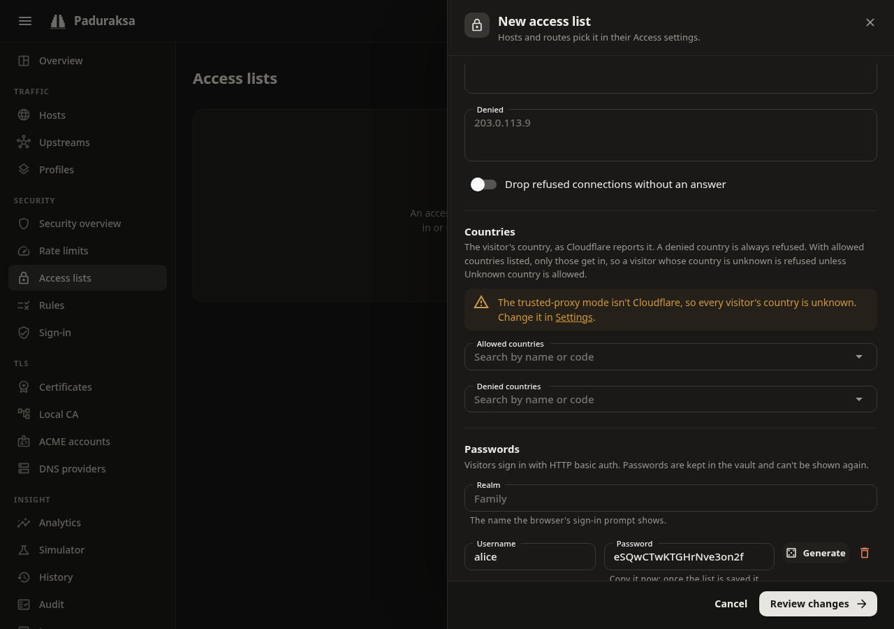

# Access control and WAF

Paduraksa's protections are named objects that you define once and attach to hosts, profiles, the global defaults or single routes. Each is compiled into the live config, so a request pays only lookups and arithmetic.

| Block | Where | What it does |
|---|---|---|
| [Access lists](#access-lists) | Security, *Access lists* | Allow or deny addresses and countries, and ask for a password |
| [Rule sets](#rule-sets) | Security, *Rules* | Refuse, drop or allow by path, method and user agent |
| [Rate limits](#rate-limits) | Security, *Rate limits* | Token buckets that answer `429` |
| [Sign-in](#sign-in-with-your-identity-provider) | Security, *Sign-in* | Forward-auth to authentik, Authelia, oauth2-proxy or your own endpoint |
| [Browser check](#browser-check-proof-of-work) | A host setting | A proof of work a plain scraper does not pass |
| [robots.txt](#robotstxt) | A host setting | A managed file for crawlers |

Connection floods, slow clients, request sizes and client addresses are on [Connections, limits and client addresses](connections-and-limits.md). Cloudflare's origin lockdown is on [Behind Cloudflare](cloudflare.md).

## What runs first

For a request to a proxy host, the gate runs in this order, and stops at the first refusal:

1. The connection stage, before TLS: the per-address cap and the deny list.
2. The host's address and country rules. A denied address is dropped or refused here, so it learns nothing about the host.
3. Request limits (`414`, `431`), then the HTTPS redirect, then `robots.txt` and the answers of Redirect and Respond hosts.
4. Rule sets, then the route's access list (addresses, then passwords), then the rate limit, then sign-in, then the browser check.

A rule set runs before the access list that asks for passwords, so a refused request costs no password check and no rate-limit token. The rate limit runs before the browser check, so a client over budget gets a `429`, not a challenge page. `GET` and `HEAD /robots.txt` are never ruled on, limited or challenged, because a `4xx` there tells a crawler it may go anywhere.

## Attaching a block

A host, profile or the global defaults has one setting for each: **Access list**, **Rules**, **Sign-in** and **Rate limit**. Each picks *inherit*, *none* or a named object, with **New ...** to make one without leaving the form.

- A route can inherit its host's choice, name another, or turn it off for its own paths. A route that serves the sign-in provider's own pages must turn sign-in off.
- Deleting an object that a host, profile, default or route still names is refused.
- Redirect and Respond hosts have no routes. The host's access list and rules apply to them. A rate limit and the browser check work on routes, so they never apply to these hosts.

## Access lists

An access list combines addresses, countries and basic-auth users.

### Addresses

- **Allowed** and **denied** addresses, one per line, as single addresses or CIDR ranges (IPv4 and IPv6).
- A denied address is refused whatever it sends.
- A non-empty allow list admits only its addresses.
- **Drop** closes the connection without an answer where the address decided, instead of a `403`.
- The address judged is the client's: see [Connections, limits and client addresses](connections-and-limits.md#client-addresses).

### Countries

Countries come from Cloudflare's `CF-IPCountry` header, trusted only from a Cloudflare peer. **Paduraksa v0.1 has no local country database.** Outside Cloudflare's Proxy and Tunnel modes every country is unknown, so a country allow list refuses everyone. The review warns when a host uses a list with country rules and the client address mode is not Cloudflare.

- Two letters are a country (`DE`). `T1` is Tor, kept apart so you can block it. `XX`, a missing or a repeated header is *unknown*.
- Deny wins. An unknown country is refused when the list has a country allow list, unless `XX` is in it.
- A list with both an address allow list and a country allow list needs a request to be in **both**.

### Users and passwords

The list can ask for HTTP basic auth.

- A username is 1 to 64 visible ASCII characters with no `:`, and case-sensitive. A list holds at most 1000 users.
- A password is set in the drawer. Leave the box empty to keep the stored one. **Generate** fills 20 random letters and digits and shows them once.
- The password goes to the vault, hashed with PBKDF2-SHA-256 (210 000 iterations). The config document, its revisions, exports, the audit log and API responses carry only a credential ID, never a password or a hash. A config export has no passwords, so restore a full [backup](../operating/backups.md) to keep them.
- A user without a password cannot sign in, and the review warns about it. A rollback or an import brings back the users a revision named, with the password the vault holds at that moment.
- **Realm** is the name the browser's prompt shows. It defaults to the list's name.
- A wrong or missing password is a `401` with `WWW-Authenticate: Basic`. A name nobody has costs the same as a wrong password, so timing does not reveal who exists.
- Verified credentials are remembered per client address for up to five minutes. Checks run in a bounded line: when it is full or the wait passes 10 seconds, the client gets a `429` with `Retry-After: 1`.
- **Pass credentials upstream** is off by default: once the list accepts the credentials, Paduraksa removes `Authorization` before the upstream sees it. A visitor the list let through without asking keeps their own `Authorization`.
- A host that asks for a password without forcing HTTPS is warned about, because the password would cross the network in clear.
- A password change is a change: it makes a revision (of the list's users, never of the password) and moves the list's version.

### How the parts combine

With users and address rules both present, **How they combine** decides:

| Choice | An allowed address | A visitor outside the allow list |
|---|---|---|
| Address and password (the default) | Asked for a password | Refused with `403` |
| Address or password | Let in without a password | Asked for a password, which lets them in |

A denied address or country is refused either way. No users means the address rules alone, and no address rules means the password alone.

### Use a list for the connection deny list and for maintenance

- The global [connection deny list](connections-and-limits.md#connection-floods) uses only a list's **denied addresses**.
- A host's maintenance **bypass** uses only a list's **address side**: its allow rules, and no password. See [Hosts and routes](hosts-and-routes.md#maintenance-mode).

## Rule sets

A rule set is an ordered list of rules. Each rule has conditions and an action.

Conditions (all that a rule states must hold, and a rule needs at least one):

- **Path:** *exact*, *prefix*, *glob* or *regex*, matched against the canonical path (case-insensitively).
- **Methods:** a set, such as `POST`.
- **User agent:** *contains* any of some case-insensitive substrings, or *empty* (which also matches a missing or blank one).

Actions:

- **Deny:** `403` with the built-in page.
- **Drop:** abort the connection with no answer.
- **Allow:** carve an exception out of the denies after it. An allow ends the set, but the rest of the chain still runs.

The first rule a request matches decides. A request no rule matches goes on.

- A set holds at most 200 rules. A glob has at most 126 characters and wildcards.
- Regexes run on a linear-time engine, so a pattern that would backtrack catastrophically elsewhere costs no more than a plain one here.
- Write a path decoded, as a request would be after canonicalization. A pattern no canonical path could equal is refused.

### Built-in presets

Three read-only sets that you can name directly. **Copy to edit** makes your own copy, which is how you add to one.

| Preset | Refuses |
|---|---|
| Block AI crawlers | The user agents of known AI crawlers. The same list as the `robots.txt` preset, refreshed with each release |
| Block known scanners | `sqlmap`, `nikto`, `nmap`, `masscan`, `zgrab` and `nuclei`. The list is short on purpose: it removes noise, not attackers |
| Block empty user agent | Scripts and some health checks |

## Rate limits

A rate limit policy is a token bucket: **requests** per second, minute or hour, a **burst**, and a **key**.

| Key | One bucket per |
|---|---|
| Client IP | Client address. An IPv6 address counts by its /64 |
| Client IP and path | Address and the canonical path (`/API` and `//api;` share one) |
| Header | The value of a request header you name. A request without it falls back to the client address |

- A request over budget gets `429` with `Retry-After`.
- Two hosts that name one policy do not share a client's budget: buckets belong to a (policy, host) pair. A route that uses the host's policy shares the host's buckets.
- Editing the rate or burst keeps the buckets. The new numbers apply on the next request.
- A rate limit applies to the routes of proxy hosts and the admin host. It does not apply to unknown hosts, `404`s, ACME challenges, the browser check's verify endpoint or Redirect and Respond hosts.

## Sign-in with your identity provider

**Sign-in** puts an authentication provider in front of a host or a route. Before a request is forwarded, Paduraksa asks the provider's endpoint whether to let it through (forward-auth). This works with authentik, Authelia and oauth2-proxy, or any endpoint that answers allow or refuse.

A provider has an endpoint URL and a preset:

| Preset | Endpoint it calls | Identity headers copied upstream | Decision cached |
|---|---|---|---|
| authentik (proxy outpost) | `/outpost.goauthentik.io/auth/traefik` | `X-authentik-*` | Per host |
| Authelia | `/api/authz/forward-auth` | `Remote-User`, `Remote-Groups`, `Remote-Name`, `Remote-Email` | Per request (path and method) |
| oauth2-proxy | `/oauth2/auth` | `X-Auth-Request-User`, `-Email`, `-Groups`, `-Preferred-Username` | Per host |

Give a bare address and the preset adds its path. A field you leave empty takes the preset's value.

Other fields: **Timeout** (1 to 30 seconds, default 5), **Cache** (0 to 300 seconds, default 10; 0 remembers nothing), extra request headers to send, response headers to copy upstream (a trailing `*` is a prefix), and the **sign-in URL** with its return parameter.

How it behaves:

- The call is a `GET` with no body. The original method goes in `X-Forwarded-Method`, and the original request in `X-Forwarded-Proto`, `-Host`, `-Uri` and `-For`. Of the client's own headers only `Cookie`, `Authorization`, `Proxy-Authorization`, `User-Agent`, `Accept`, `Accept-Language` and `X-Requested-With` are sent.
- A `2xx` lets the request on. The provider's identity headers are added to the request, and the client's own copies of those names (and of `_` spellings of them) are removed on **every** route of the host, so a client cannot forge `Remote-User` through a route that skips the check.
- A `401`, `403`, `407` or a redirect is relayed (status, body up to 64 KiB, `Location`, `Set-Cookie`, `WWW-Authenticate`).
- A `401` to a browser navigation goes to the sign-in URL with the original address in the return parameter. A request for the sign-in page itself is never redirected.
- It fails closed. An unreachable endpoint, or an answer Paduraksa cannot forward, is a `502`. A timeout is a `504`. More than 64 calls in flight is a `503` with `Retry-After: 1`. None of them lets the request through.
- `Authorization` and `Cookie` cannot be named as response headers, so the client's credentials always reach the upstream as sent.
- The endpoint is your own address. A client cannot choose it. An `https://` endpoint is verified against the system roots, with no "accept any certificate" option, so use `http://` on a private network or a certificate the host trusts.
- `robots.txt` is not exempt from sign-in: it protects what the upstream serves.

Provider-specific setup:

- **authentik:** route `/outpost.goauthentik.io/` on the protected host to the outpost, with sign-in **off** on that route, for the callback.
- **oauth2-proxy:** route `/oauth2/` on the host to oauth2-proxy, with sign-in off. A bare `401` to a browser navigation becomes a redirect to `/oauth2/start?rd=<original URL>`.
- **Authelia:** its access-control rules decide by resource, method and network.

The review warns when a layer names a provider above a layer that switched sign-in off (the merged result is off, and naming a provider does not switch it back on), and when the provider's sign-in page is itself behind a provider.

## Browser check (proof of work)

The **Browser check** (a host setting) protects a route from clients that will not do work. A visitor without a valid cookie gets a small page that solves a proof of work in the browser, once. Then a signed cookie (`paduraksa_pow`) lets them through.

- **Difficulty:** leading zero bits of SHA-256 a solution needs, 8 to 28 (default 16, well under a second on an ordinary laptop). Each extra bit doubles the work, for the visitor and for a bot.
- **Cookie lifetime:** 1 to 720 hours (default 168, seven days).
- A route can switch it on or off for its own paths. Use that to exempt `/api` on a host that is otherwise protected.
- The cookie is bound to the host and the client address (a /32, or a /64 for IPv6). It is `HttpOnly`, `SameSite=Lax`, and `Secure` over HTTPS.
- A browser with JavaScript solves it. Anything else that asks for HTML gets the page. A client that does not ask for HTML and has no cookie gets `403`.
- The solver is plain JavaScript in Web Workers, so it works on a non-secure origin.
- A host with the check on that serves plain HTTP without forcing HTTPS is warned about, because the cookie cannot be `Secure` there.
- If the signing key cannot be opened, every protected route answers `503` rather than letting requests through.
- A challenge is stateless, so a solved one can be redeemed again within its ten minutes. That yields only a cookie for the same host and address.
- Redirect and Respond hosts are never challenged.

## robots.txt

The **robots.txt** setting (global defaults, a profile or a host; not per route) is one of:

- **Pass through:** the upstream answers (the default).
- **Disallow all:** `Disallow: /` for everyone.
- **Block AI crawlers:** each known AI crawler gets `Disallow: /`, every other crawler is allowed. The list is built in and refreshed with each Paduraksa release.
- **Custom:** your text, served as typed with a final newline.

It is answered from memory with `Cache-Control: max-age=3600`, so a change is picked up within the hour. It is answered after the host's access rules and the HTTPS redirect and before route matching, so a Redirect or Respond host can carry one too.

[Analytics](observability.md#analytics) lists the bots that ignore it.

## The Security overview

**Security overview** (Security) answers "what is protecting my hosts, and is it working".

- One line: what the gate refused in the last 24 hours, and the reasons (rate limit, access list, rules, ...). It links to the security section of Analytics.
- A table of hosts with what protects each: browser check, rate limit, access list, `robots.txt`, rules and sign-in, and how many of its requests were refused in the last 24 hours. A route that differs from its host is grouped, such as "Off on 2 routes". Hosts with nothing on come last.

It reads the live config, not the stored one, so it is what the gate is doing.

The counters themselves are the **Security** section at the bottom of [Analytics](observability.md#analytics), over the page's range (1 h, 24 h, 7 d, 30 d):

- the refusals per second over time, stacked by reason;
- a card each for proof of work, rate limits, access lists, the connection stage and sign-in;
- the requests the gate answered without a policy (unknown host, no route), once there are some.

They are kept with the metrics, so a restart doesn't reset them, and they are for the whole process: the host picker doesn't change them. Refusals stored before the reasons were kept count as "unknown reason". The same data is `GET /api/v1/security/overview?range=hour|day|week|month`.

## Defaults for new hosts

A new host is unprotected until you opt in. Put the protections you always want in the **global defaults** or in a **profile** ("LAN only", "Public app") and let hosts inherit them. A host with the **Access list** setting set to a LAN-only list is a simple way to keep a service off the internet.
